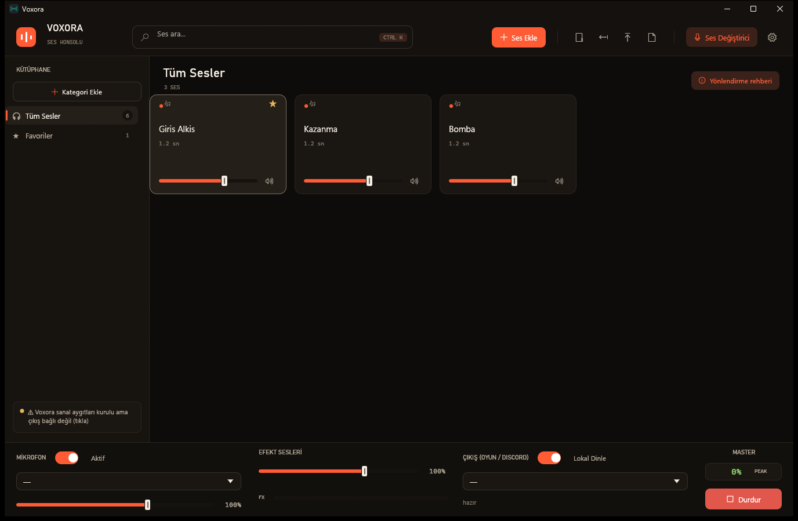

# Voxora Rust

Windows için Rust ile geliştirilmiş, Voxora'nın bağımsız soundpad sürümü. Sesleri kısayollarla çalabilir, mikrofon ve efektleri yönlendirebilir, F1 radyal menüsünden seçebilirsiniz.

**Rust sürümünün sürüm numarası C# sürümünden bağımsızdır.** C# projesi: [ObsQrr/Voxora](https://github.com/ObsQrr/Voxora).



## Kullanım

1. [Sürümler](https://github.com/ObsQrr/VoxoraRust/releases) sayfasından **`VoxoraRust-1.0.0-setup.exe`** kurucusunu veya taşınabilir ZIP'i indirin.
2. Kurucuyu çalıştırın; uygulama kullanıcı hesabınıza kurulur, Başlat menüsü ve masaüstü kısayolu oluşturulur.
3. Oyun veya Discord'a ses aktarmak için uygun bir sanal ses kablosu ayrıca kurulmalıdır.
4. Bir sesi kaldırmak için karttaki çöp kutusuna veya sağ tık menüsündeki **Kütüphaneden Kaldır** seçeneğine basın ve onaylayın. Bu işlem kaynak ses dosyasını diskten silmez.

### Kurulum ve kaldırma

- Kurulum yeri: `%LOCALAPPDATA%\Programs\VoxoraRust`; yönetici izni gerekmez.
- Kaldırma: **Ayarlar → Uygulamalar → Voxora Rust → Kaldır**. Kısayollar ve program dosyaları silinir; `%APPDATA%\Voxora` altındaki ayarlar, kitaplık ve sesler korunur.
- Sessiz kurulum (otomasyon): `VoxoraRust-1.0.0-setup.exe --silent --no-launch`. Kurulumdan sonra uygulamayı açmamak için `--no-launch` kullanılır.
- Taşınabilir sürüm kurulum gerektirmez: ZIP'i açıp `voxora.exe` dosyasını çalıştırın.

Uygulama ve paket imzasızdır; Windows SmartScreen uyarısı gösterebilir. Ayarlar ve kitaplık varsayılan olarak `%APPDATA%\Voxora` altında saklanır. `VOXORA_DATA_DIR` başka bir veri klasörü seçer.

## Özellikler

- Ses kartları, kategoriler, favoriler, arama ve sürükle-bırak içe aktarma.
- Efekt miksajı, mikrofon, lokal monitör, ducking ve ses değiştirici.
- Genel kısayollar, F1 radyal menüsü, tepsi simgesi, Türkçe/İngilizce ve açık/koyu tema.
- Kitaplık ZIP içe/dışa aktarma ve isteğe bağlı cihaz adı değiştirme.

## C# sürümüyle farkları

| | Rust 1.0 | C# Voxora |
|---|---|---|
| Teknoloji | Rust, egui/OpenGL ve CPAL/WASAPI | C#, WPF ve .NET |
| Dağıtım | Windows x64 kurucu EXE + taşınabilir paket | Windows kurucusu ve taşınabilir paket |
| Güncelleme | Rust sürüm sayfası tarayıcıda açılır; elle indirilir | C# sürümünün kendi güncelleme yolu |
| Veri | `%APPDATA%\Voxora`; C# JSON alanlarının bir kısmı uyumlu | Kendi veri klasörü ve sürüm hattı |
| Radyal menü | Ayrı şeffaf, odak çalmayan Windows katmanı | WPF tabanlı ayrı katman |

JSON biçimlerinin bazı alanları uyumlu olsa da **tam veri ve özellik uyumluluğu garanti edilmez**. Taşımadan önce kitaplığınızı yedekleyin; kişisel dosyaları iki uygulama arasında doğrudan ortak kullanmayın. Uygulamalar aynı Windows başlangıç kaydını kullanabilir; birlikte kullanırken otomatik başlatma seçeneğine dikkat edin.

Geçmiş testlerde Rust sürümü daha küçük bellek ve disk kullanımı göstermiştir; ancak önceki ölçüm araçlarının bazı sınırlamaları bulunduğundan burada doğrulanmamış performans yüzdeleri verilmemektedir.

## Bilinen sınırlar

- Tam ekran özel oyunlarda radyal katman görünmeyebilir; çoklu monitör/DPI kapsamı sınırlı test edilmiştir.
- Tepsi menüsü Türkçedir. UAC ile cihaz adı değiştirme yolu canlı onayla doğrulanmamıştır.
- Fiziksel mikrofonla uzun süreli ses/kararlılık testi ve bu sürüm için karşılaştırmalı benchmark yapılmamıştır.
- Kaynak dosyasının diskten silinmesi otomatik yapılmaz. Ses sürücüleri ve 48 kHz stereo desteği gereklidir.

## Geliştirme

Windows, Rust ve Microsoft C++ Build Tools gereklidir:

```powershell
cargo test --workspace
cargo build --release -p voxora-app
```

Çıktı `target/release/voxora.exe`. Ek komutlar: `--version`, `--self-test`, `--page settings`. Self-test ses aygıtlarını açabilir.

Kurulum EXE'si, taşınabilir ZIP hazırlandıktan sonra `installer\build-setup.ps1` ile üretilir; ZIP'i gömülü taşıyan ayrı bir Rust programıdır. Ayrıntılar `crates/setup` altında.

Kaynak kodu MIT lisansı altında sunulur; bağımlılıkların kendi lisansları geçerlidir.
