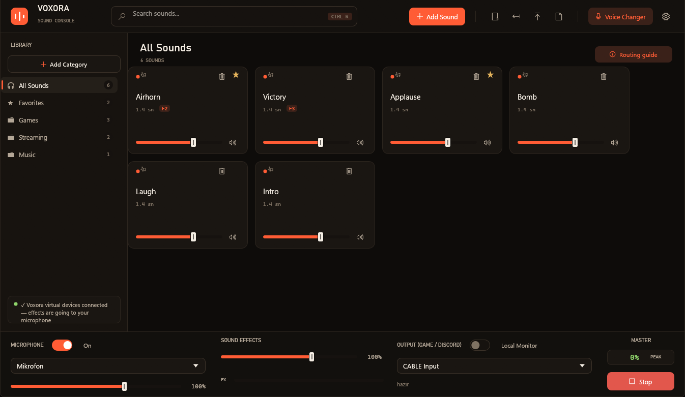

# Voxora Rust

[English](#english) · [Türkçe](#türkçe)

## English

Voxora is a free, open-source soundboard for Windows, built in Rust. It keeps a local library of your own audio clips and plays them instantly from global hotkeys or an on-screen radial menu. Sounds can be organised into categories, searched, marked as favourites, muted and balanced with a per-sound volume slider. The mixer combines effects with your microphone, optionally ducks the microphone while a clip plays, and can monitor the result on a second output device.



**Current Rust edition: 1.0.0.** The original C#/WPF edition (2.2.1) is maintained separately at [ObsQrr/Voxora](https://github.com/ObsQrr/Voxora). Both editions are MIT-licensed.

### Download

- **Installer (recommended):** [VoxoraRust-1.0.0-setup.exe](https://github.com/ObsQrr/VoxoraRust/releases/download/v1.0.0/VoxoraRust-1.0.0-setup.exe) — 5,984,768 bytes, SHA-256 `0878181FE0134F294380257DA6F5044121A065D5F5D6EF177E1F6ECB3B6EEBDF`
- **Portable ZIP:** [VoxoraRust-1.0.0-win-x64.zip](https://github.com/ObsQrr/VoxoraRust/releases/download/v1.0.0/VoxoraRust-1.0.0-win-x64.zip) — 5,591,442 bytes, SHA-256 `A76844733C19AA48FEDC09DB336D58DC70248EE6547A5DB02C28E2D098853C8C`
- All releases: [github.com/ObsQrr/VoxoraRust/releases](https://github.com/ObsQrr/VoxoraRust/releases)

The installer is per-user, needs no administrator rights and creates Start Menu and desktop shortcuts. **Settings → Apps → Voxora Rust → Uninstall** removes the program and shortcuts; `%APPDATA%\Voxora` (settings, library and sounds) is preserved. Silent install: `VoxoraRust-1.0.0-setup.exe --silent --no-launch`.

No account, ads, analytics or bundled sound library. If “Check for updates” is enabled, the app contacts the GitHub releases API; otherwise it does not need the network.

### Features

- Local sound library with categories, favourites, instant search, drag-and-drop import, per-sound volume and mute.
- Global hotkeys, restart/overlap/toggle playback modes and hold-to-play behaviour.
- Transparent radial menu that opens over the current application without stealing focus; mouse wheel pages through sounds.
- Microphone chain with pitch shift, robot, echo and telephone effects, ducking and a limiter.
- Optional local monitor on a separate output device; microphone feedback is not sent to the monitor.
- ZIP library import/export and optional Windows audio-endpoint renaming.
- English/Turkish interface, dark/light themes, tray icon, start-with-Windows option.
- Per-user installer and a portable ZIP; no .NET, Electron or WebView runtime required.

### Requirements

- Windows 10 or Windows 11, 64-bit. Tested on Windows 11 25H2; Windows 10 is expected to work but has not been tested.
- A 48 kHz stereo output device; a microphone is optional.
- **VB-CABLE or another compatible virtual audio cable** for routing sound into Discord or game voice chat. Voxora does not install a virtual audio driver.
- About 15 MB installed; installer ~6 MB, portable ZIP ~5.3 MB. Installing VB-CABLE may require administrator rights.

### Known limitations

- No built-in virtual audio driver; VB-CABLE is a separate third-party download and must be selected as the output device.
- No audio recorder, waveform editor, normalisation, community sound library or AI voices.
- Windows only; no macOS, Linux or mobile edition.
- The voice changer is a simple DSP effect set, not an AI voice platform.
- The radial menu may not appear over exclusive-fullscreen games; multi-monitor/DPI coverage is limited.
- Builds are unsigned, so Windows SmartScreen may warn.
- The optional UAC path for renaming audio endpoints has not been verified on a live approval flow.
- Updates are not installed automatically; the app opens the GitHub release page.
- A few status strings may remain Turkish in the English interface.
- Physical-microphone and long-duration stability tests have not been completed.

### Development

Windows, Rust 1.86+ and Microsoft C++ Build Tools are required:

```powershell
cargo test --workspace
cargo build --release -p voxora-app
```

Output: `target/release/voxora.exe`. Extra commands: `--version`, `--self-test`, `--page settings`. Self-test opens audio devices. The setup executable is built after the portable ZIP with `installer\build-setup.ps1`; see `crates/setup`.

Source code is MIT-licensed; dependencies keep their own licences.

---

## Türkçe

Windows için Rust ile geliştirilmiş, Voxora'nın bağımsız soundpad sürümü. Sesleri kısayollarla çalabilir, mikrofon ve efektleri yönlendirebilir, F1 radyal menüsünden seçebilirsiniz.

**Rust sürümünün sürüm numarası C# sürümünden bağımsızdır.** C# projesi: [ObsQrr/Voxora](https://github.com/ObsQrr/Voxora).


### Kullanım

1. [Sürümler](https://github.com/ObsQrr/VoxoraRust/releases) sayfasından **`VoxoraRust-1.0.0-setup.exe`** kurucusunu veya taşınabilir ZIP'i indirin.
2. Kurucuyu çalıştırın; uygulama kullanıcı hesabınıza kurulur, Başlat menüsü ve masaüstü kısayolu oluşturulur.
3. Oyun veya Discord'a ses aktarmak için uygun bir sanal ses kablosu ayrıca kurulmalıdır.
4. Bir sesi kaldırmak için karttaki çöp kutusuna veya sağ tık menüsündeki **Kütüphaneden Kaldır** seçeneğine basın ve onaylayın. Bu işlem kaynak ses dosyasını diskten silmez.

### Kurulum ve kaldırma

- Kurulum yeri: `%LOCALAPPDATA%\Programs\VoxoraRust`; yönetici izni gerekmez.
- Kaldırma: **Ayarlar → Uygulamalar → Voxora Rust → Kaldır**. Kısayollar ve program dosyaları silinir; `%APPDATA%\Voxora` altındaki ayarlar, kitaplık ve sesler korunur.
- Sessiz kurulum (otomasyon): `VoxoraRust-1.0.0-setup.exe --silent --no-launch`. Kurulumdan sonra uygulamayı açmamak için `--no-launch` kullanılır.
- Taşınabilir sürüm kurulum gerektirmez: ZIP'i açıp `voxora.exe` dosyasını çalıştırın.

Uygulama ve paket imzasızdır; Windows SmartScreen uyarısı gösterebilir. Ayarlar ve kitaplık varsayılan olarak `%APPDATA%\Voxora` altında saklanır. `VOXORA_DATA_DIR` başka bir veri klasörü seçer.

### Özellikler

- Ses kartları, kategoriler, favoriler, arama ve sürükle-bırak içe aktarma.
- Efekt miksajı, mikrofon, lokal monitör, ducking ve ses değiştirici.
- Genel kısayollar, F1 radyal menüsü, tepsi simgesi, Türkçe/İngilizce ve açık/koyu tema.
- Kitaplık ZIP içe/dışa aktarma ve isteğe bağlı cihaz adı değiştirme.

### Sistem gereksinimleri

- Windows 10 veya Windows 11, 64-bit. Windows 11 25H2'de test edildi; Windows 10 denenmedi.
- 48 kHz stereo çıkış aygıtı; mikrofon isteğe bağlı.
- Discord/oyun sesine yönlendirme için **VB-CABLE veya uyumlu bir sanal ses kablosu**. Voxora sanal ses sürücüsü kurmaz.
- Kurulu uygulama yaklaşık 15 MB; kurucu ~6 MB, taşınabilir ZIP ~5,3 MB.

### C# sürümüyle farkları

| | Rust 1.0 | C# Voxora |
|---|---|---|
| Teknoloji | Rust, egui/OpenGL ve CPAL/WASAPI | C#, WPF ve .NET |
| Dağıtım | Windows x64 kurucu EXE + taşınabilir paket | Windows kurucusu ve taşınabilir paket |
| Güncelleme | Rust sürüm sayfası tarayıcıda açılır; elle indirilir | C# sürümünün kendi güncelleme yolu |
| Veri | `%APPDATA%\Voxora`; C# JSON alanlarının bir kısmı uyumlu | Kendi veri klasörü ve sürüm hattı |
| Radyal menü | Ayrı şeffaf, odak çalmayan Windows katmanı | WPF tabanlı ayrı katman |

JSON biçimlerinin bazı alanları uyumlu olsa da **tam veri ve özellik uyumluluğu garanti edilmez**. Taşımadan önce kitaplığınızı yedekleyin; kişisel dosyaları iki uygulama arasında doğrudan ortak kullanmayın. Uygulamalar aynı Windows başlangıç kaydını kullanabilir; birlikte kullanırken otomatik başlatma seçeneğine dikkat edin.

Geçmiş testlerde Rust sürümü daha küçük bellek ve disk kullanımı göstermiştir; ancak önceki ölçüm araçlarının bazı sınırlamaları bulunduğundan burada doğrulanmamış performans yüzdeleri verilmemektedir.

### Bilinen sınırlar

- Sanal ses sürücüsü yok; VB-CABLE ayrı kurulmalı ve çıkış aygıtı olarak seçilmelidir.
- Ses kaydedici, dalga formu editörü, normalizasyon, topluluk ses kütüphanesi ve AI sesler yok.
- Yalnızca Windows; macOS, Linux veya mobil sürüm yok.
- Ses değiştirici basit DSP efektlerinden oluşur; AI ses platformu değildir.
- Tam ekran özel oyunlarda radyal katman görünmeyebilir; çoklu monitör/DPI kapsamı sınırlı test edilmiştir.
- Tepsi menüsü Türkçedir. UAC ile cihaz adı değiştirme yolu canlı onayla doğrulanmamıştır.
- Fiziksel mikrofonla uzun süreli ses/kararlılık testi ve bu sürüm için karşılaştırmalı benchmark yapılmamıştır.
- Kaynak dosyasının diskten silinmesi otomatik yapılmaz. Ses sürücüleri ve 48 kHz stereo desteği gereklidir.

### Geliştirme

Windows, Rust ve Microsoft C++ Build Tools gereklidir:

```powershell
cargo test --workspace
cargo build --release -p voxora-app
```

Çıktı `target/release/voxora.exe`. Ek komutlar: `--version`, `--self-test`, `--page settings`. Self-test ses aygıtlarını açabilir.

Kurulum EXE'si, taşınabilir ZIP hazırlandıktan sonra `installer\build-setup.ps1` ile üretilir; ZIP'i gömülü taşıyan ayrı bir Rust programıdır. Ayrıntılar `crates/setup` altında.

Kaynak kodu MIT lisansı altında sunulur; bağımlılıkların kendi lisansları geçerlidir.
